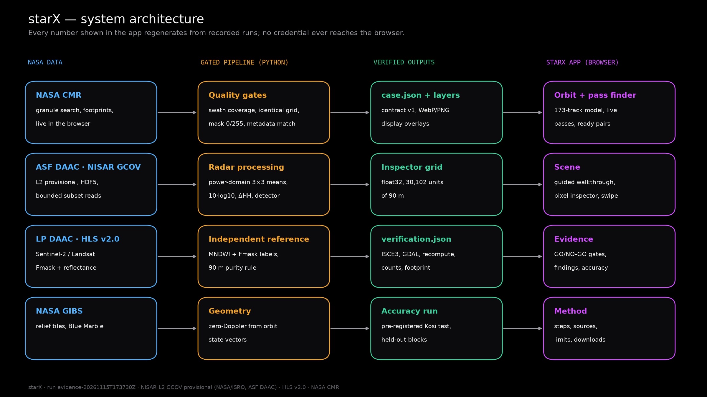
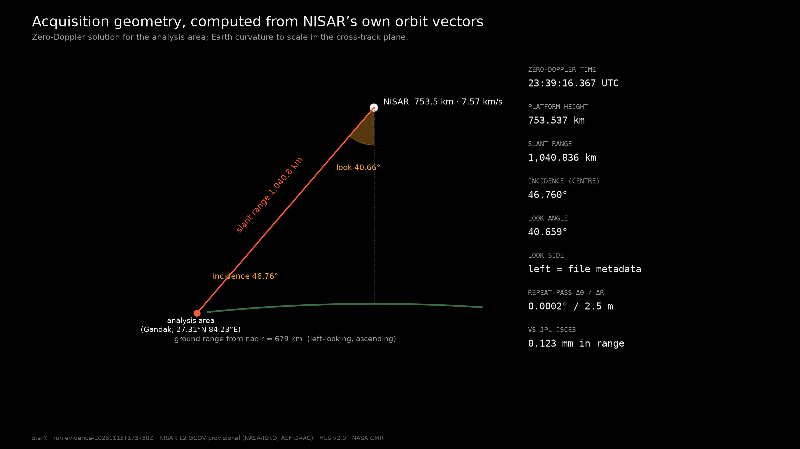
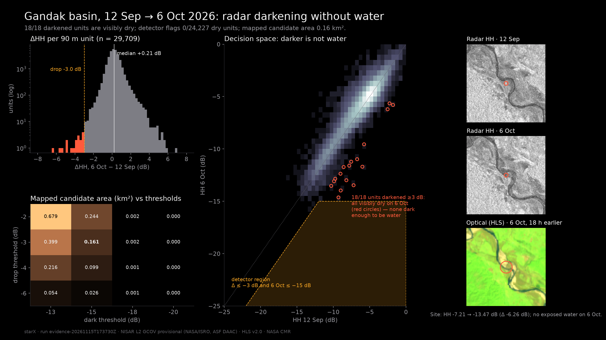
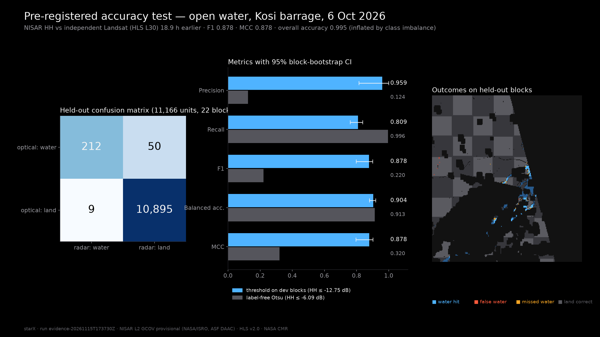
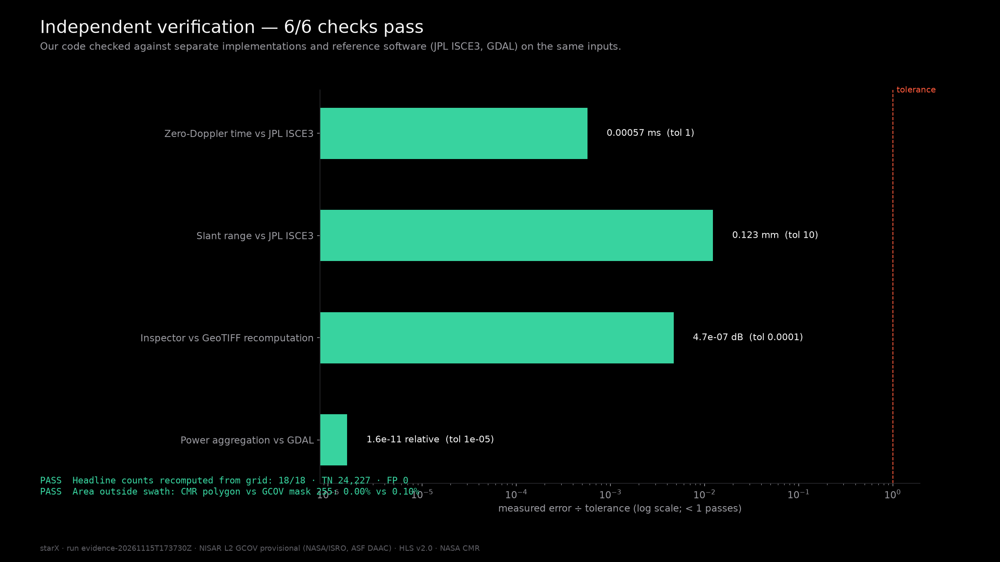

# starX — NISAR evidence explorer

NASA Space Apps Challenge 2026 · *Dancing with the SARs*.

starX makes NISAR radar change understandable — anywhere on Earth — and shows when a change is backed by independent evidence.

- **Orbit + pass finder:** NISAR's 12-day orbit anchored to the spacecraft's own ephemeris; click any point for every real NISAR pass (live NASA CMR), the next passes, measured repeat precision, and verification-ready optical pairs.
- **Scene:** real NISAR L2 GCOV radar (Gandak basin, Bihar) — change composite, ΔHH, HH/HV — with a guided walkthrough and a pixel inspector.
- **Evidence:** GO/NO-GO quality gates, a pre-registered accuracy test (Kosi River: F1 0.878, MCC 0.878 on held-out areas), and independent verification (geometry matches JPL ISCE3 to 0.12 mm).

Status: *observed, not evaluated* for flood (new-water) detection — the September optical reference was too cloudy. Limits are stated in the app.

Data: NISAR L2 GCOV provisional (NASA/ISRO, ASF DAAC), HLS v2.0 (NASA LP DAAC; Copernicus Sentinel-2 and Landsat), NASA CMR, NASA GIBS (ASTER GDEM relief, Blue Marble). Third-party code and fonts keep their licences in `vendor/` (Leaflet BSD-2, globe.gl/three.js MIT, Inter and DM Mono OFL-1.1). Not endorsed by NASA.

## Diagrams and results

| | |
|---|---|
|  |  |
|  |  |
|  | Demo (30 s): [demo/starX-demo-30s.mp4](demo/starX-demo-30s.mp4) |

All figures are generated by script from the recorded run outputs (no hand-entered numbers).
